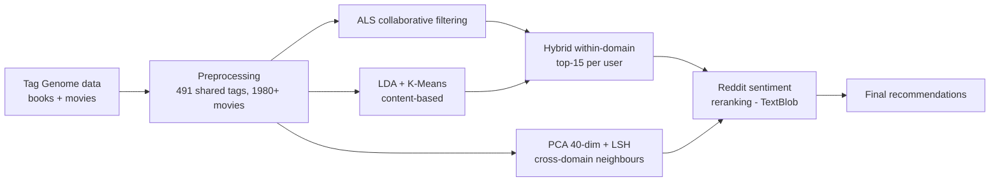

# Movie & Book Recommender System

## Overview
This project implements a hybrid recommendation system that generates personalized suggestions for books and movies in both:

- **Within-domain** (books → books, movies → movies)
- **Cross-domain** (books → movies, movies → books)

The system is enhanced with **Reddit-based sentiment analysis**, allowing recommendations to reflect real community opinions.

---

## Key Features
- Hybrid recommendation system (Collaborative + Content-Based)
- Cross-domain recommendation using shared tag embeddings
- Dimensionality reduction (PCA) + similarity search (LSH)
- Topic modeling (LDA) + clustering (K-Means)
- Reddit API integration for sentiment-based reranking

### Pipeline



---

## Results

**Scale.** The pipeline runs in PySpark on ~25M movie ratings (movies released 1980 or later, out of 28.5M) and ~17M book and movie tag-relevance scores, aligned on **491 tags** shared by both domains. The cross-domain model links **9,374 books** with **4,061 movies**.

**Within-domain ranking quality (books)**, evaluated with PySpark `RankingMetrics` on 9,542 test users:

| Metric | @5 | @15 |
|---|---|---|
| Precision | 0.213 | 0.071 |
| Recall | 0.359 | 0.359 |
| NDCG | – | **0.459** |

*Note:* the metrics are computed on recommended items that also appear in a user's test set (only these have a known rating), so they are optimistic compared to a full-catalogue evaluation. The movie side could only be evaluated on a very small overlap of users, so we do not report it here.

The system:
- Generates 15 personalized recommendations for every user in both domains
- Bridges domains (books ↔ movies) through a shared tag space
- Reranks the final lists using Reddit community sentiment

---

## Tech Stack
- **Python**
- pandas, numpy, scikit-learn
- NLP: TextBlob
- PySpark (ALS, RankingMetrics)
- Reddit API (PRAW)

---

## Project Structure
```
movie-book-recommender-system
│
├── notebooks
│ ├── 0_preprocessing.ipynb
│ ├── 1_within-domain_model.ipynb
│ ├── 2_cross-domain_model.ipynb
│ ├── 3_evaluation.ipynb
│ ├── 4_reddit_enrichment_books.ipynb
│ └── 5_reddit_enrichment_movies.ipynb
│
└── README.md
```

---

## Methodology

### 1. Data Preprocessing
- Unified tag vocabulary across books and movies
- Filtered items by release year (post-1980)
- Cleaned and transformed metadata and ratings

---

### 2. Within-Domain Recommendations
- ALS collaborative filtering on user-item interactions
- Content-based model using:
  - LDA (topic modeling)
  - K-Means clustering
- Hybrid scoring combining both approaches

---

### 3. Cross-Domain Recommendations
- Shared tag representation for books and movies
- PCA for dimensionality reduction (40 dimensions)
- LSH for efficient nearest-neighbor search

---

### 4. Reddit-Based Enrichment
- Scraped posts and comments via Reddit API
- Computed sentiment scores using TextBlob
- Reranked recommendations using sentiment weighting

---

## Evaluation
- Precision@K
- Recall@K
- NDCG
- Implemented using PySpark RankingMetrics

---

## Data
The project uses the **[Tag Genome Dataset for Books and Movies](https://grouplens.org/datasets/book-genome/)** (Kotkov et al., 2022, GroupLens). It contains book and movie metadata, user ratings, tag-relevance scores (`tagdl.csv`) and a book–movie tag matching file (`matching.csv`), which makes cross-domain recommendation possible.

Due to size constraints, the raw data is not included in this repository. To reproduce the results, download the dataset and place it in `./raw_data/`.

---

## Authors
Developed in a team of three as part of a university project. We all collaborated on the overall design of the system.

**My contributions:**
- Built the complete Reddit sentiment enrichment (notebooks 4 and 5): data collection via the Reddit API, sentiment scoring and reranking
- Contributed to the model evaluation
- Contributed to combining the components into the full system
